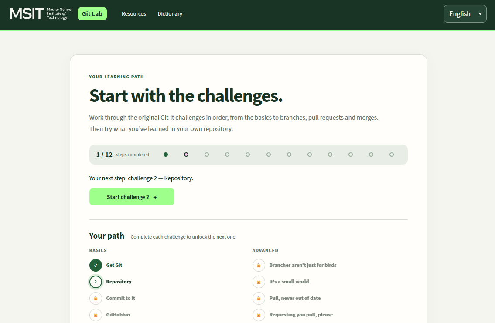
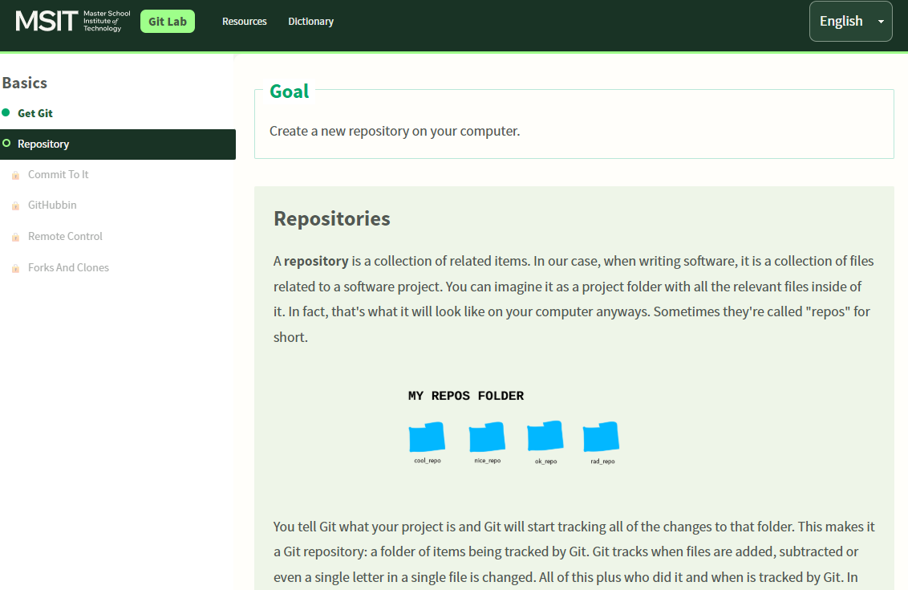
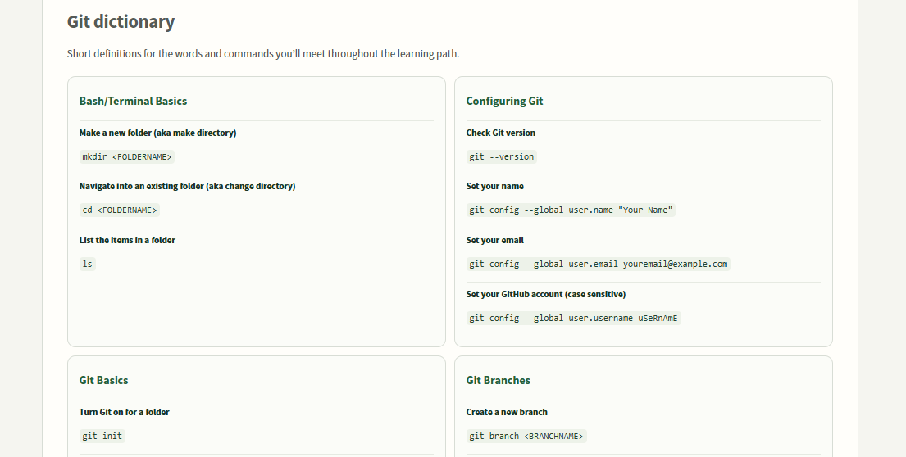

# MSIT Git Lab

**Learn Git by doing it.** MSIT Git Lab is a desktop learning tool for students who want to get comfortable with Git and GitHub through real commands, guided challenges, and repeatable practice.

It keeps the original 11 Git-it challenges and builds on them with intermediate and advanced labs. You type commands in your regular terminal; the app guides you and checks your repository when you are ready. The app is available in English and informal German (`du`).

## Download

Download the latest desktop installer from the project’s GitHub release:

- [Download for macOS (universal DMG)](https://github.com/devmunro/msit-git-lab/releases/latest/download/MSIT-Git-Lab-macOS-universal.dmg)
- [Download for Windows (x64 installer)](https://github.com/devmunro/msit-git-lab/releases/latest/download/MSIT-Git-Lab-Windows-x64-Setup.exe)
- [Browse all releases](https://github.com/devmunro/msit-git-lab/releases)

Release downloads are published from tagged builds. macOS releases are signed and notarized when the project’s Apple release credentials are configured; Windows installers are signed when the Windows certificate is configured. Without signing credentials, downloads are still published, but macOS Gatekeeper or Windows SmartScreen may show a warning before the app opens.

## Screenshots

### Learning path

Start with the original challenges and unlock each next step by completing the one before it.



### Git challenge

Follow the lesson, work in your repository, and verify your progress in the app.



### Quick reference

Look up Git terms and commands in the compact dictionary while you learn.



## What you’ll practice

The learning path starts with Git installation, repositories, commits, GitHub, remotes, forks, and clones. It continues through branches, pull requests, and merging, then adds labs for:

- Staging changes and writing commits
- Creating branches, merging, and resolving conflicts
- Working with remotes and pull requests
- Stashing work and applying it later
- Rebasing and interactive rebase
- Cherry-picking commits
- Using reset and reflog to recover work
- Creating and inspecting tags
- Finding the commit that introduced a bug with `git bisect`

Practice the original Git-it challenges with a repository you choose. For history-changing exercises, use the app’s resettable practice repositories so you can safely try again. Optional knowledge checks can help you pause and think through a concept; hands-on command practice remains the focus.

## Getting started

Install Git, then open MSIT Git Lab and begin with the first challenge. You’ll need a GitHub account for the collaboration challenges that use GitHub. For each lesson, follow the instructions and type the commands in your regular terminal. Select your working repository when the app asks you to verify a challenge.

Git 2.39 or newer is recommended. The app uses your installed system Git and does not bundle Git.

## Run from source

You’ll need Node.js 22, npm, and Git installed.

```sh
npm ci
npm start
```

## Build locally

```sh
npm test
npm run build-all
npm run make
```

Electron Forge creates a macOS universal app and ZIP on macOS, and a Windows x64 setup installer on Windows. macOS DMG creation uses the built-in `hdiutil` tool. See [the release guide](docs/release-process.md) for branch and release steps.

## Roadmap

We’re building this as a practical learning resource for courses and for your own projects:

- **More intermediate practice:** deepen workflows with remotes, pull requests, rebasing, and recovering from mistakes.
- **More advanced scenarios:** add realistic team workflows, complex conflict practice, and multi-step debugging exercises.
- **More ways to learn:** add optional knowledge checks with useful explanations, and clear visual explanations of how commits and branches move.
- **Accessibility:** improve keyboard support, screen-reader guidance, contrast, reduced-motion support, and lesson readability.
- **Classroom use:** explore instructor-friendly setup and progress options while keeping learner repositories private and local by default.
- **Language quality:** keep English and informal German lessons aligned, with fluent review of German copy.

Suggestions and student feedback are welcome through [GitHub Issues](https://github.com/devmunro/msit-git-lab/issues).

## Credits

MSIT Git Lab is based on [Git-it by Jessica Lord](https://github.com/jlord/git-it-electron). The original Git-it challenges and attribution are retained. See [LICENSE](LICENSE) for the BSD-2-Clause license. MSIT branding belongs to Master School Institute of Technology.
